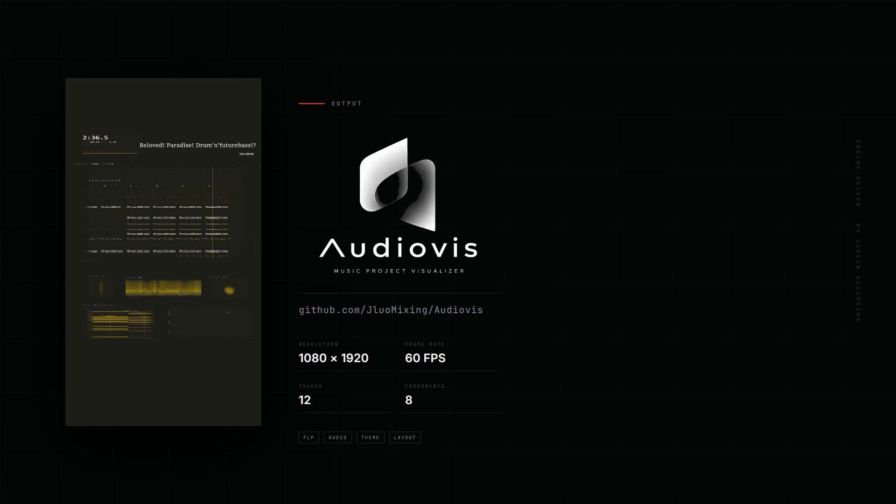
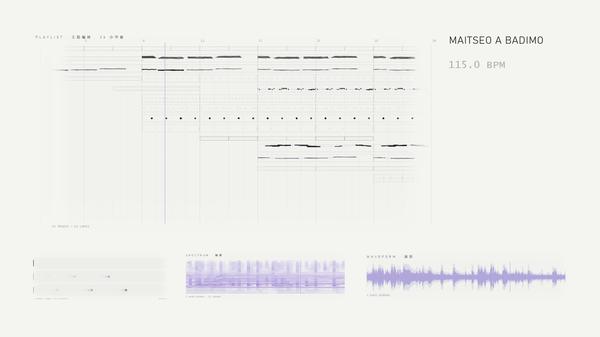
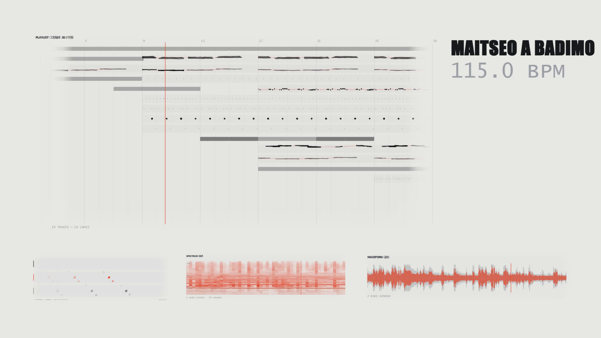
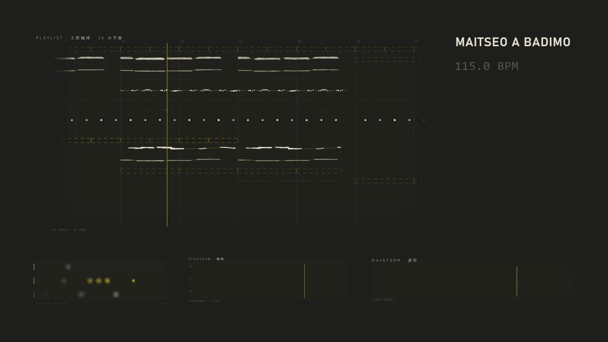
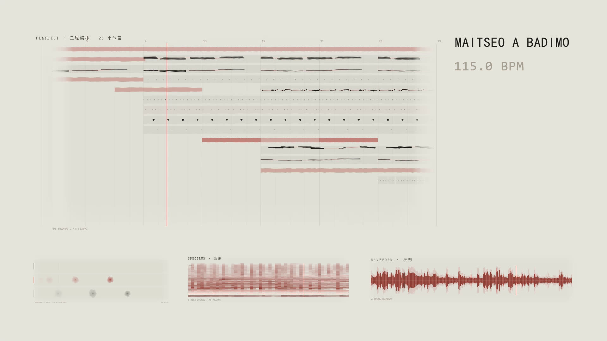
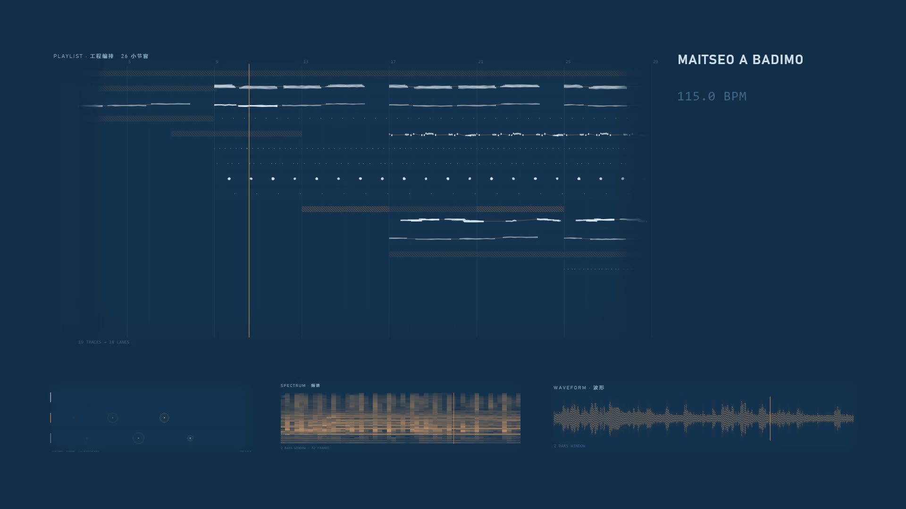

# Audiovis

**为 FL Studio 制作人设计的工程可视化视频生成器。**

把你的 FLP 工程变成一条风格统一的展示视频 —— 不是录屏，不是套模板，
而是**真正读取你的工程结构**：Playlist 编排、Pattern、Clip、音符，
配上真实音频分析，同步渲染成视频。

## 宣传片

[](docs/video/audiovis_promo_16x9.mp4)

**▶ 点封面播放**（78 秒 · 1080p60）｜ [竖屏版](docs/video/audiovis_promo_9x16.mp4)

> GitHub 的 README 不支持内联视频播放（仓库里的 mp4 以
> `application/octet-stream` 返回，浏览器会当成下载），
> 所以这里用封面图 + 链接。点开就是 GitHub 自带的播放器。

---

## 和普通可视化有什么区别

普通的频谱可视化只看音频，画面和你的工程没有任何关系。

Audiovis 读的是**工程本身**：

| 它知道 | 所以画面能显示 |
|---|---|
| 你有 19 条轨道、18 个 Clip 在播 | 真实的 Playlist 编排，而不是随机波形 |
| 第 3 轨是鼓组、用了 5 个 Pattern | 步进器按你的鼓点节奏亮起 |
| 每个音符的音高、力度、时长 | 钢琴卷帘、音级轮按真实数据绘制 |
| 哪里是副歌、哪里只有鼓 | 画面密度跟着音乐结构走 |

**结果是：观众能看出这是一首具体的歌，不是任意一首。**

---

## 效果预览

同一首曲子，12 套主题，风格完全不同：

### 白塑料 · SOFT HARDWARE
> 一台 2003 年的白色设备。哑光白面板，唯一的颜色是一颗淡紫指示灯。



### 异形铬 · CHROME FREAK
> 地下时装 lookbook 的排版。超粗窄体出血切边，荧光朱红只出现一次。



### 核警示 · NUCLEAR
> 警示黄的几何逻辑：中心 + 三等分。不画辐射标志本身，只借它的构图。



### 墨 · 紙 · SUMI
> 水墨与爵士唱片封套。朱砂只作印章出现一次，是全画面唯一的红。



### 図面 · BLUEPRINT
> 工程图纸。所有元素都是标注，琥珀色是唯一的高亮。



**完整 12 套主题**：默认 / 墨·紙 / 図面 / 長曝光 / 構成 / 磁帶 / 星図 / 織 / 孔版 / 白塑料 / 异形铬 / 核警示

---

## 功能

### 拖拽式编辑
12 个组件自由组合：主时间轴、步进器、频谱、波形、钢琴卷帘、
音级轮、声场、响度、明亮度、瞬态、走带读数、文字。

拖进画布、调大小、改属性 —— 实时预览。

### 6 套预设模板
横屏 / 竖屏各一套坐标，套上就能导出。也可以从空白开始。

### 所见即所得
**预览和导出用的是同一份绘制代码**，不是两套实现。
界面里看到什么样，导出的视频就是什么样（有逐像素测试守着）。

### 两种画幅
- 横屏 1920×1080（YouTube / B站）
- 竖屏 1080×1920（抖音 / Shorts / Reels）

---

## 安装

[](https://github.com/JluoMixing/Audiovis/releases/latest)
[](https://github.com/JluoMixing/Audiovis/releases/latest)
[](LICENSE)
[](https://github.com/JluoMixing/Audiovis/releases/latest)

### 方式一：下载即用（推荐）

**[⬇ 下载最新版](https://github.com/JluoMixing/Audiovis/releases/latest)**

1. 解压到任意目录
2. 双击 `Audiovis.exe`

**不需要安装 Python、Node.js 或 ffmpeg** —— 全部已打包（约 100 MB）。

**系统要求**：Windows 10/11 x64，WebView2 运行时（Win11 自带；Win10 通常已随 Edge 安装）。

### 方式二：从源码运行

```powershell
# 环境：Python 3.9+、Node.js 18+
pip install numpy soundfile imageio-ffmpeg pywebview
python run.py
```

首次启动会自动检查依赖、构建界面、打开窗口。

---

## 使用流程

```
1. 选 FLP 工程 + 对应的混音音频
        ↓
2. 自动解析：轨道、Clip、Pattern、音符、音频特征
        ↓
3. 选模板 或 从空白开始拖组件
        ↓
4. 选主题（12 套）
        ↓
5. 点「导出视频」
```

导出时有进度条，可随时取消。

---

## 主题系统

每套主题定义四层：

| 层 | 控制什么 |
|---|---|
| **色板** | 8 个基础色 + 3 个数据色（数据主体 / 峰值 / 弱信号） |
| **字体** | display / body / mono 三套字体与字号 |
| **质感**（SURFACE） | 组件的填充、描边、标记、网格怎么画 |
| **绽放**（BLOOM） | 音符落点怎么动 |

**加一套主题只需 4 步**，详见 [`docs/ADD_THEME.md`](docs/ADD_THEME.md)。

---

## 组件系统

每个组件是一个自包含的渲染单元：

```js
register({
  id: 'mytool', name: '我的组件', w: 420, h: 300, group: '音频',
  绘制: function (g, w, h, 样式) {
    // g 是 Canvas 2D 上下文，坐标原点是组件左上角
  },
});
```

**加一个组件只需 3 步**（建文件 → 重建 → 完成，构建清单自动扫描目录）。
详见 [`docs/ADD_COMPONENT.md`](docs/ADD_COMPONENT.md)。

---

## 已知限制

- **只测过 FL Studio 21.1.1.3750**、PPQ 96 的工程
- 只在 **Windows** 上验证
- **不支持** Automation Clip 的完整解析、Mixer / Plugin Chain 视图
- 只做离线渲染，没有实时播放

---

## 技术栈

| 层 | 技术 |
|---|---|
| 界面 | 原生 HTML/CSS/JS + Canvas 2D |
| 窗口 | pywebview（WebView2），真无边框 |
| 服务 | Python 标准库 `http.server` |
| 渲染 | CDP 驱动无头 Edge，逐帧截图 |
| 编码 | imageio-ffmpeg（内置 ffmpeg 7.1 + libx264） |
| 打包 | PyInstaller onedir |

**没有前端框架、没有构建工具链** —— 打开就是源码。

---

## 开发者文档

| 文档 | 内容 |
|---|---|
| [`AGENTS.md`](AGENTS.md) | 开发入口：架构、关键约束、踩过的坑 |
| [`docs/INDEX.md`](docs/INDEX.md) | 文档索引 |
| [`docs/ADD_THEME.md`](docs/ADD_THEME.md) | 加主题 |
| [`docs/ADD_COMPONENT.md`](docs/ADD_COMPONENT.md) | 加组件 |
| [`docs/PACKAGING.md`](docs/PACKAGING.md) | 自己打包 |
| [`docs/ROADMAP.md`](docs/ROADMAP.md) | 设计决策记录 |

---

## 许可证

**GPL-3.0-or-later**

本项目使用 GPL v3，因为依赖的 [PyFLP](https://github.com/demberto/PyFLP)
（FLP 解析库）是 GPL-3.0-or-later，且被链接进本程序。

这意味着：你可以自由使用、修改、分发，但**衍生作品也必须开源**。

详见 [`LICENSE`](LICENSE) 与 [`docs/VENDOR_VERSIONS.md`](docs/VENDOR_VERSIONS.md)。

---

## 致谢

- [PyFLP](https://github.com/demberto/PyFLP) —— FLP 文件解析
- [pywebview](https://github.com/r0x0r/pywebview) —— 桌面窗口宿主
- [imageio-ffmpeg](https://github.com/imageio/imageio-ffmpeg) —— 视频编码
